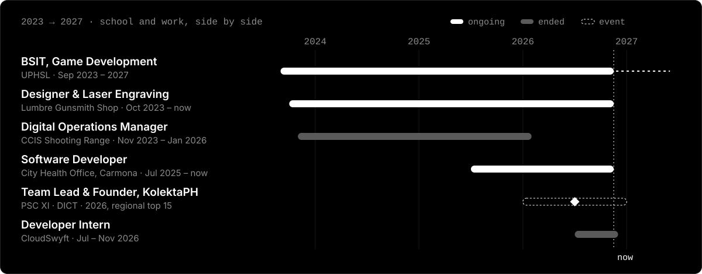
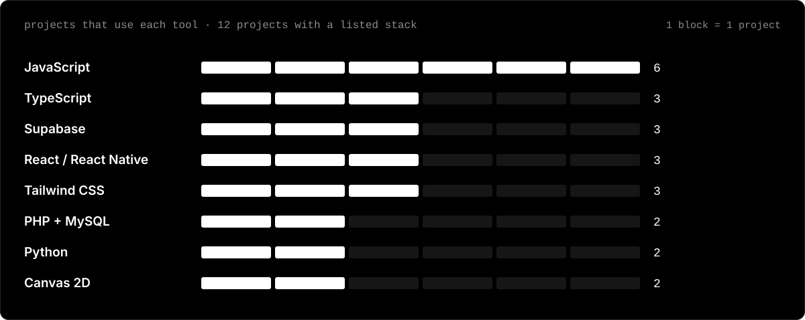

<!--
  ============================================================
  MAKHEYL  /  GITHUB PROFILE README
  ============================================================

  PALETTE  (black theme, white is the only accent)
    Black     #000000   cards, badges, typing line
    Border    #262626   card borders, empty cells
    Grid      #161616   gridlines, empty blocks
    Dim       #5A5A5A   ended roles, mid cells
    Muted     #8B8B8B   secondary text
    White     #FFFFFF   accent, primary text

  ASSETS  (assets/, plain SVG, no external fonts or images)
    header.svg ....... banner card, CSS cursor blink + cell pulse
    timeline.svg ..... experience timeline, HAND-MAINTAINED
    built-with.svg ... tools per project, HAND-MAINTAINED
    The two charts keep their source data in a comment at the top
    of each file. Update them when the portfolio changes: move the
    "now" line in timeline.svg, recount built-with.svg.

  SNAKE  (~/activity)
    .github/workflows/snake.yml runs daily, on push to main, and by
    hand from the Actions tab. It writes snake.svg to the "output"
    branch, which this README loads from raw.githubusercontent.com.

  REMOTE SERVICES
    Typing line ...... readme-typing-svg.demolab.com
    Badges ........... img.shields.io  (style=for-the-badge, 000000)

  BADGE SIZE  (read this before resizing)
    GitHub forces height:auto on images in markdown, so a height
    attribute is ignored. Size is controlled by width only, and each
    badge has its own natural width, so each img carries its own.
    To resize, scale every width by the same factor.

  BADGES WITH NO ICON  (not a typo, the icons do not exist)
    simple-icons dropped these marks: LinkedIn, Photoshop, Power Apps.
    C# uses logo=dotnet as a stand-in.
  ============================================================
-->

 

## ~/about

I build SaaS for startups and competitions, and I like turning rough ideas into things people actually use.
I recently finished a developer internship at CloudSwyft, and I have been the software developer for the City Health Office of Carmona since July 2025.
I am a 4th-year BSIT student majoring in game development at UPHSL and a Dean's Lister, building SDG-aligned capstone games on the side.

## ~/highlights

<table>
  <tr>
    <td><b>PSC XI · DICT</b></td>
    <td>Regional top 15, Region IV-A. Team lead and founder of KolektaPH</td>
  </tr>
  <tr>
    <td><b>Biñan StartUp Competition</b></td>
    <td>Finalist with JobMatch</td>
  </tr>
  <tr>
    <td><b>CloudSwyft</b></td>
    <td>Developer intern, Jul to Nov 2026. Built CloudSwyftCRM on Power Apps, Lists, SharePoint and Power Automate</td>
  </tr>
  <tr>
    <td><b>City Health Office, Carmona</b></td>
    <td>Software developer since Jul 2025. Built the out-patient and laboratory queueing systems</td>
  </tr>
  <tr>
    <td><b>Credentials</b></td>
    <td>Dean's Lister · Unity Certified User: Artist · SHS With High Honors and Research Award</td>
  </tr>
  <tr>
    <td><b>Creative</b></td>
    <td>19 works across pubmats, graphic design and Blender · Head of Creatives at CSSC and the AWS Learning Club · Multimedia Director at GDC</td>
  </tr>
</table>

## ~/projects

<table>
  <tr>
    <td><a href="https://github.com/makheyl/kolektaph"><b>KolektaPH</b></a></td>
    <td>Real-time garbage truck tracking and barangay SMS alerts for Carmona. Resident, driver and city dashboard apps from one Expo codebase</td>
    <td><code>top 15</code></td>
  </tr>
  <tr>
    <td><a href="https://github.com/makheyl/JobMatch"><b>JobMatch</b></a></td>
    <td>Job matching and career guidance for Biñan, with fair-hiring rules enforced on the server</td>
    <td><code>finalist</code></td>
  </tr>
  <tr>
    <td><a href="https://github.com/makheyl/ebook-maker"><b>Folio</b></a></td>
    <td>Browser editor for interactive ebooks. Every book exports as one offline HTML file</td>
    <td><code>web app</code></td>
  </tr>
  <tr>
    <td><a href="https://github.com/makheyl/bayanihan-rescuegame"><b>Bayanihan</b></a></td>
    <td>Steer a bangka through a flooded barangay and ferry residents to safety</td>
    <td><code>sdg 11</code></td>
  </tr>
  <tr>
    <td><a href="https://github.com/makheyl/shhkool-ui"><b>SHHKOOL</b></a></td>
    <td>Classroom noise game played with your actual voice</td>
    <td><code>sdg 4</code></td>
  </tr>
  <tr>
    <td><a href="https://github.com/makheyl/music-mixer"><b>Music Mixer</b></a></td>
    <td>Detects BPM, key and chords of two songs, scores the mix and exports a mashup</td>
    <td><code>ai tool</code></td>
  </tr>
  <tr>
    <td><a href="https://github.com/makheyl/php-lab-queueing"><b>Lab Queue</b></a></td>
    <td>Laboratory queueing for the City Health Office, with kiosk boards and reports</td>
    <td><code>gov</code></td>
  </tr>
</table>

All 13 projects are on <a href="https://makheyl-portfolio.vercel.app/projects.html">the portfolio</a>.

## ~/timeline

## ~/stack

 

 

 

## ~/activity

more at <a href="https://makheyl-portfolio.vercel.app/">makheyl-portfolio.vercel.app</a>

